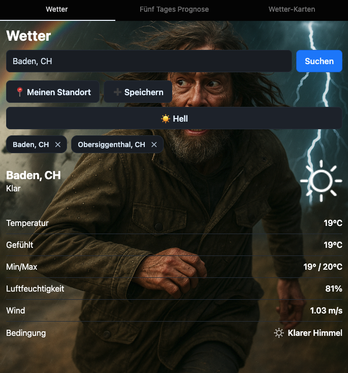

# Expo Weather

Eine deutschsprachige Wetter-App für iOS, Android, Expo Go und Web. Sie zeigt aktuelles Wetter, eine Fünf-Tage-Prognose, gespeicherte Orte, GPS-Standortsuche und einen animierten Niederschlagsradar.



## Expo Snack

Die gespeicherte Vorschau ist unter [github.com/peterruler/weather-app auf Expo Snack](https://snack.expo.dev/@petethegreat/github.com-peterruler-weather-app) erreichbar. Ein gespeicherter Snack übernimmt lokale Repository-Änderungen nicht automatisch; nach einem Push muss die GitHub-Version dort erneut importiert beziehungsweise gespeichert werden.

Der direkte Root-Import trifft derzeit einen Fehler im Expo-Importserver, sobald Repository-Assets weitergeleitet werden (`Failed to upload file asset`, Validierungsfehler `"$": Required`). Die Dateien selbst sind gültig und lassen sich über denselben Expo-Endpunkt einzeln sowie parallel hochladen. Für einen zuverlässigen Neuimport enthält das Repository deshalb die assetfreie SDK-54-Ansicht im Ordner `snack`:

1. In Snack **Import git repository** öffnen.
2. Repository URL: `https://github.com/peterruler/weather-app`
3. **Show advanced options** wählen.
4. Folder path: `snack`
5. Branch name: `main`
6. **Import repository** wählen und den importierten Snack speichern.

Der Snack-Ordner nutzt in Expo gespeicherte, inhaltsadressierte Bild-URLs statt binärer Repository-Assets. `snack/app.json` setzt `sdkVersion` ausdrücklich auf `54.0.0`, deaktiviert Laufzeit-Updates, `snack/package.json` hält alle Laufzeitabhängigkeiten exakt auf dem geprüften SDK-54-Stand und `snack/index.js` ermöglicht eine isolierte lokale Web-Prüfung. Der Root der lokalen App bleibt davon unberührt und verwendet weiterhin seine lokalen Grafiken.

## Technischer Stand

- Expo SDK 54.0.36
- React Native 0.81.5 / React 19.1
- TypeScript 5.9
- Open-Meteo für Ortssuche, Wetter und Vorhersage – ohne API-Key
- RainViewer Weather Maps API für Radarframes
- CARTO mit OpenStreetMap-Daten für die Radar-Grundkarte
- npm mit reproduzierbarer Installation über `package-lock.json`

## Voraussetzungen

- Node.js 20.19 oder neuer
- npm (wird mit Node.js installiert)
- Für ein echtes Gerät: die aktuelle Expo Go App und Gerät/Computer im selben Netzwerk

Eine globale Expo-CLI ist nicht nötig. Alle Befehle verwenden die lokale CLI über `npx expo`.

## Installation

```bash
git clone <repository-url>
cd weather-app
chmod +x install.sh run.sh
./install.sh
```

Es ist keine `.env`-Datei und kein Wetter-API-Key erforderlich. Ortssuche, aktuelle Werte und Prognose verwenden die öffentlichen Open-Meteo-Endpunkte. Dadurch kann weder ein fehlender noch ein abgelaufener Schlüssel einen 401-Fehler verursachen.

Die Open-Meteo-Daten stehen unter CC BY 4.0. Die App zeigt deshalb bei allen Wetterdaten eine anklickbare Quellenangabe; bei einer Weiterverwendung muss diese Attribution erhalten bleiben.

`install.sh` prüft die Node-Version, installiert exakt den Lockfile-Stand mit `npm ci` und kontrolliert die Expo-SDK-Kompatibilität.

Expo-Pakete und native Bibliotheken sind exakt auf die von SDK 54.0.36 freigegebenen Versionen gesetzt. `.npmrc` erzwingt auch bei späteren Installationen exakte Versionen. Eine pauschale Aktualisierung kann Expo Go oder den Snack inkompatibel machen.

Die aus dem referenzierten Frontend-Snack abgeleitete Upgrade-Hilfe ändert standardmäßig nichts:

```bash
npm run expo:align        # nur Abweichungen anzeigen
npm run expo:align:write  # SDK-54-Pins bewusst in package.json eintragen
npm install
npm run doctor
```

`expo:align:write` nur für eine beabsichtigte Wiederherstellung dieses SDK-Stands verwenden. Ein echter Wechsel auf ein neueres Expo SDK erfordert eine bewusste Anpassung des Skripts, der Dokumentation und aller Tests.

## Update-Verhalten

In `app.json` sind Expo Updates deaktiviert (`enabled: false`) und automatische Prüfungen auf `NEVER` gesetzt. Native Release-Builds verwenden dadurch ausschließlich das eingebettete JavaScript-Bundle und laden keine OTA-Aktualisierungen.

Das friert jedoch weder die Expo-Go-App noch die von Expo betriebene Snack-Laufzeit ein. Expo Go unterstützt jeweils nur ausgewählte aktuelle SDKs. Wenn SDK 54 dort künftig nicht mehr angeboten wird, ist ein eigener Development Build der reproduzierbare Weg.

## App starten

```bash
./run.sh
```

Der Expo-Entwicklungsserver zeigt einen QR-Code. Diesen mit Expo Go scannen; unter iOS erfolgt das über die Kamera-App, unter Android direkt in Expo Go. Beim ersten Zugriff die Standortberechtigung erlauben.

Weitere Startmodi:

```bash
./run.sh web          # Web-Entwicklung im Browser
./run.sh android      # Android-Gerät/Emulator über Expo
./run.sh ios          # iOS-Simulator über Expo (nur macOS)
./run.sh clear        # Metro-Cache leeren und neu starten
./run.sh web-export   # Produktions-Web-Bundle nach dist/ exportieren
```

Zusätzliche Expo-Optionen werden weitergereicht, zum Beispiel `./run.sh start --tunnel`, falls das lokale Netzwerk den QR-Code-Zugriff blockiert.

Expo Go ist eine Entwicklungs- und Vorschauumgebung, kein Deployment-Ziel. Für eine veröffentlichte native App und für dauerhaft reproduzierbare SDK-54-Tests sollte ein Development Build beziehungsweise EAS Build konfiguriert werden. Der Produktions-Web-Export liegt nach `./run.sh web-export` in `dist/` und kann bei einem statischen Hosting-Anbieter veröffentlicht werden.

## Bedienung

1. Im Tab **Wetter** einen Ort suchen oder **Meinen Standort** wählen.
2. Optional bis zu fünf Orte speichern; `✕` entfernt einen Eintrag.
3. Im Prognose-Tab die nächsten fünf Tage ansehen.
4. Im Tab **Niederschlagsradar** die Radarframes manuell wechseln oder animieren.

Der rote Punkt markiert den gewählten Ort. Ohne vorherige Wetterabfrage öffnet der Radar direkt mit Zürich als Standardposition. Eine Ortssuche oder GPS-Auswahl ersetzt die Standardposition. Der Radar zeigt Messungen und – falls RainViewer sie liefert – Nowcast-Prognosen. Die Grundkarte ist bewusst nicht verschiebbar, damit dieselbe Implementierung ohne eigene native Map-Abhängigkeit in Expo Go und Web funktioniert.

## Qualität prüfen

```bash
npm run typecheck
npm test -- --runInBand
npm run lint
npm run doctor
npm run web:export
```

Alle wesentlichen Prüfungen zusammen:

```bash
npm run validate
```

Der ausführlichere UI-Testlauf verwendet das Expo-Jest-Preset:

```bash
npm run test:expo -- --runInBand
```

## Fehlerbehebung

### Standortbestimmung schlägt fehl

In den Geräte-Einstellungen die Standortberechtigung für Expo Go beziehungsweise den Development Build erlauben und die Ortungsdienste einschalten. Die App versucht vorübergehend unbekannte iOS-CoreLocation-Positionen dreimal. Wetterdaten werden anschließend ohne API-Key über Open-Meteo abgerufen; ein 401-Authentifizierungsfehler ist daher nicht mehr möglich.

### Expo Go meldet eine inkompatible SDK-Version

`./install.sh` erneut ausführen, mit `npm run expo:align` die exakten Versionen prüfen und danach `./run.sh clear` starten. Dieses Projekt ist bewusst auf SDK 54.0.36 ausgerichtet. Falls die installierte Expo-Go-Version SDK 54 nicht mehr unterstützt, einen passenden Development Build verwenden; die deaktivierten OTA-Updates können die Expo-Go-Kompatibilität nicht erzwingen.

### Gerät erreicht den lokalen Entwicklungsserver nicht

Beide Geräte müssen normalerweise im selben Netzwerk sein. VPN oder Firewall testweise deaktivieren oder `./run.sh start --tunnel` verwenden.

### Radar lädt nicht

Eine Internetverbindung ist erforderlich. Die App bietet **Erneut versuchen** und zeigt eine verständliche Fehlermeldung, wenn RainViewer nicht erreichbar ist. Browser-Content-Blocker müssen Zugriffe auf `api.rainviewer.com`, `tilecache.rainviewer.com` und `a.basemaps.cartocdn.com` zulassen.

### `npm audit` meldet moderate Probleme

Das Projekt überschreibt Expo Metros verwundbare PostCSS-8.4-Version gezielt mit der gepatchten Version 8.5.26. Die verbleibenden Meldungen betreffen moderate Probleme im SDK-54-Werkzeugbaum; npm bietet dafür derzeit SDK 57 als Lösung an. `npm audit fix --force` nicht verwenden, weil dies den bewusst fixierten SDK-54-Stand aufhebt. Expo-Versionen nur über den dokumentierten, vollständigen Upgrade-Weg aktualisieren.

## Projektstruktur

```text
weather-app/
├── App.tsx                    # Zustand, APIs und Navigation
├── src/
│   ├── components/
│   │   └── RadarViewer.tsx    # Plattformübergreifende Radar-Karte
│   ├── lib/
│   │   ├── radarComposite.ts  # RainViewer-Timeline und Tile-Geometrie
│   │   └── weatherApi.ts      # Open-Meteo-Ortssuche und Wetterdaten
│   ├── screens/               # Wetter, Prognose und Radar
│   └── utils.ts
├── __tests__/                 # Jest-Tests
├── .npmrc                     # Exakte npm-Versionen statt Bereichsangaben
├── scripts/
│   └── upgrade-expo.js        # Explizite SDK-54-Ausrichtung
├── snack/                     # Assetfreie, SDK-54-fixierte Snack-Importansicht
├── install.sh                 # Reproduzierbare Installation
├── run.sh                     # Einheitlicher Start/Export
├── CLAUDE.md                  # Wartungs- und Agentenleitfaden
└── CHANGELOG.md               # Laufende Änderungen
```

## Datenquellen und Lizenz

- Wetter- und Prognosedaten: [Open-Meteo](https://open-meteo.com/)
- Ortsdaten der Open-Meteo-Geocodierung: [GeoNames](https://www.geonames.org/)
- Radardaten: [RainViewer](https://www.rainviewer.com/)
- Grundkarte: [© OpenStreetMap-Mitwirkende und © CARTO](https://carto.com/attributions)
- Quellcode: [MIT-Lizenz](./LICENSE)

Beachte für produktive beziehungsweise kommerzielle Nutzung zusätzlich die Nutzungsbedingungen, Limits und Attributionspflichten aller Datenanbieter.
